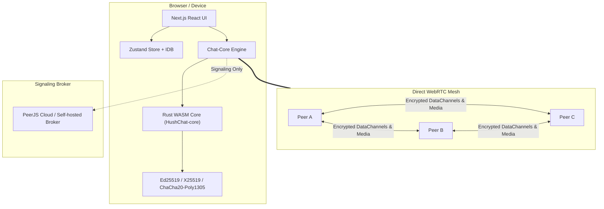

# HushChat — Serverless Encrypted P2P Communication App

HushChat is a browser-first, zero-backend, peer-to-peer communication app built with **Rust / WebAssembly**, **PeerJS**, **WebRTC DataChannels & MediaTracks**, **IndexedDB**, and **Next.js** (with native packaging via **Tauri v2**).

---

## 🚀 Key Features

- **Zero Application Server:** All text, files, and audio/video calls travel directly between peers over WebRTC DataChannels and DTLS-SRTP media tracks.
- **Rendezvous-Anchor Mesh Rooms:** Shareable-link rooms (public or private with URL fragment keys `#k=secret`). Ephemeral by default with full mesh topology and dynamic anchor failover.
- **Persistent Key-based Contacts & DMs:** Long-term Ed25519 signing keys and X25519 Diffie-Hellman encryption keys with safety number verification and offline outbox queuing in IndexedDB.
- **High-Performance Rust Core:** Cryptography, Triple-DH forward-secret session handshakes, Lamport clocks, message framing, and file chunk encryption handled in a high-security Rust core compiled to WebAssembly.
- **E2E Encrypted Audio/Video Calls:** Peer-to-peer video, audio, and screen sharing in both rooms and DMs with mute indicators and spotlight layouts.
- **Embeddable Web Component:** SDK `<peer-chat>` element for embedding encrypted rooms into any external site or blog.
- **Cross-Platform Tauri v2 Packaging:** Native desktop and mobile application shell sharing the exact same Rust core and Next.js static export frontend.

---

## 📐 Architecture



---

## 🔒 Honest Constraints & Threat Model

1. **Signaling & Broker Visibility:** The broker (PeerServer) coordinates initial WebRTC SDP handshakes. It sees PeerJS IDs and metadata, but never decrypted contents.
2. **STUN & TURN:** Direct P2P WebRTC succeeds in ~85-90% of networks; NAT/firewalls requiring relay will utilize TURN servers.
3. **Simultaneous Online Requirement:** In ephemeral rooms, messages exist only while peers are present. DMs queue in an IndexedDB outbox when contacts are offline.
4. **IP Exposure & Privacy:** Direct WebRTC reveals peer IP addresses. A **"Hide my IP (relay only)"** toggle is provided in Settings to enforce TURN relay.

---

## 🛠️ Local Development & Build

### Prerequisites
- **Rust** 1.83+ & `wasm-pack`
- **Node.js** 20+ & `npm`

### 1. Build Rust Core & WASM
```bash
# Run unit & property tests
cargo test --workspace

# Compile WASM bindings
./scripts/build-wasm.sh
```

### 2. Run Web Development Server
```bash
cd web
npm install
npm run dev
```

### 3. Build Static Export (and Tauri assets)
```bash
cd web
npm run build
```

---

## 📜 License
MIT OR Apache-2.0
